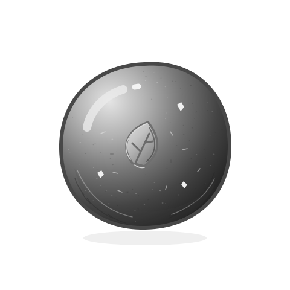
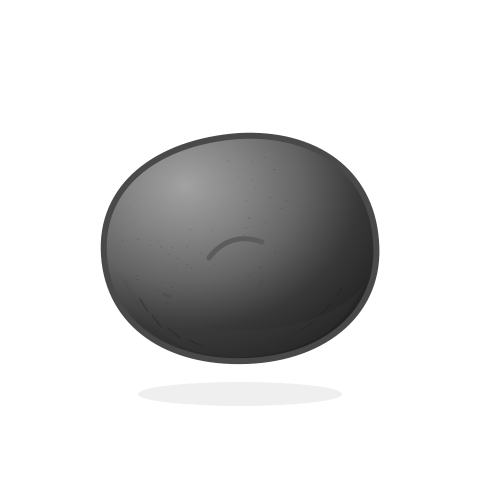
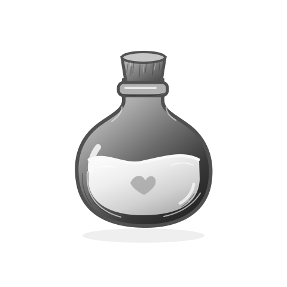
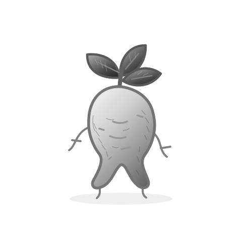
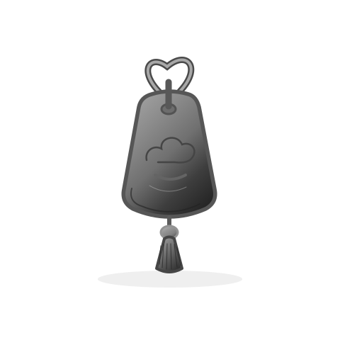
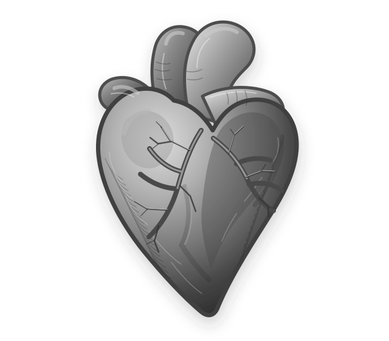
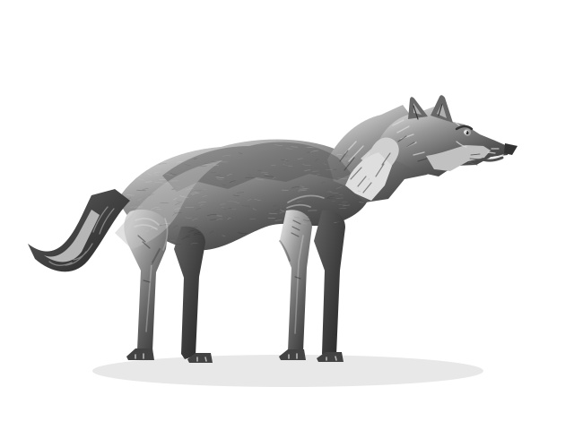

# SVG 에셋 분류 목록

현재 도감 기본 방향은 **Game-icons의 흑백 실루엣과 내부 선·여백**이다. [다운로드한 주제별 아이콘 목록](game-icons/README.md)에서 새 후보를 찾는다. 기존 수제 시안은 아래에 보관한다. [제작·평가 기준](style-guide.md)을 따른다.

장르를 선택한 뒤 분류별 목록에서 세부 대상을 고른다. 각 CSV가 단어 매핑의 원본이며, 분류별 단어 수와 실제 제작한 에셋 수를 아래에서 비교할 수 있다. 장르별 100개는 현재 선정 분량이며 분류별 확장을 제한하는 상한이 아니다.

## 경로 규칙

- 목록: `docs/assets/vocabulary/<장르>/<분류>.csv`
- SVG: `server/static/assets/svg/<장르>/<분류>/<에셋 식별자>.svg`
- 여러 장르에서 재사용하는 SVG: `server/static/assets/svg/shared/<분류>/<에셋 식별자>.svg`
- `ready`: 파일 존재. `planned`: 제작 대기이며 경로만 예약되어 있음.
- 동의어는 같은 에셋에 연결할 수 있으므로 단어 수와 에셋 수는 다를 수 있음.
- 분류는 탐색 목적이다. 종족의 선악·적대 여부나 물약의 효능을 결정하지 않음.
- 무형의 세력·경지·감정 개념은 현재 목록에서 보류.

## 현재 SVG

- [늑대](../../server/static/assets/svg/shared/animals/wolf-monochrome.svg): 무협의 늑대, 판타지의 늑대·이리
- [심장](../../server/static/assets/svg/romance/body/heart-monochrome.svg): 로맨스의 심장

## 분류별 분량

### 무협

| 분류 | 단어 수 | 에셋 후보 수 | 제작 완료 에셋 수 |
|---|---:|---:|---:|
| [무기](vocabulary/wuxia/weapons.csv) | 28 | 28 | 0 |
| [의복·방어구](vocabulary/wuxia/equipment.csv) | 8 | 8 | 0 |
| [영약·단약](vocabulary/wuxia/elixirs.csv) | 6 | 6 | 3 |
| [약재·영초](vocabulary/wuxia/herbs.csv) | 17 | 17 | 1 |
| [옥패·장신구](vocabulary/wuxia/jade-accessories.csv) | 4 | 4 | 1 |
| [재화·인장](vocabulary/wuxia/valuables.csv) | 5 | 5 | 0 |
| [서찰·비급](vocabulary/wuxia/manuscripts.csv) | 7 | 7 | 0 |
| [생활 기물](vocabulary/wuxia/household.csv) | 12 | 12 | 0 |
| [건축물](vocabulary/wuxia/architecture.csv) | 4 | 4 | 0 |
| [탈것](vocabulary/wuxia/transport.csv) | 2 | 2 | 0 |
| [동물](vocabulary/wuxia/animals.csv) | 4 | 4 | 1 |
| [식물](vocabulary/wuxia/plants.csv) | 3 | 3 | 0 |

### 판타지

| 분류 | 단어 수 | 에셋 후보 수 | 제작 완료 에셋 수 |
|---|---:|---:|---:|
| [무기](vocabulary/fantasy/weapons.csv) | 9 | 9 | 0 |
| [의복·방어구](vocabulary/fantasy/equipment.csv) | 8 | 8 | 0 |
| [마법 도구](vocabulary/fantasy/magic-tools.csv) | 16 | 16 | 0 |
| [물약](vocabulary/fantasy/potions.csv) | 3 | 3 | 0 |
| [몬스터·환수](vocabulary/fantasy/monsters.csv) | 15 | 15 | 0 |
| [판타지 종족](vocabulary/fantasy/peoples.csv) | 4 | 4 | 0 |
| [동물](vocabulary/fantasy/animals.csv) | 11 | 10 | 1 |
| [건축·시설](vocabulary/fantasy/architecture.csv) | 12 | 12 | 0 |
| [지형·자연물](vocabulary/fantasy/landscapes.csv) | 15 | 15 | 0 |
| [천체·자연 현상](vocabulary/fantasy/elements.csv) | 7 | 7 | 0 |

### 로맨스

| 분류 | 단어 수 | 에셋 후보 수 | 제작 완료 에셋 수 |
|---|---:|---:|---:|
| [상징물](vocabulary/romance/symbols.csv) | 1 | 1 | 0 |
| [신체](vocabulary/romance/body.csv) | 1 | 1 | 1 |
| [보석·장신구](vocabulary/romance/jewelry.csv) | 10 | 10 | 0 |
| [편지·추억](vocabulary/romance/letters-memories.csv) | 10 | 10 | 0 |
| [꽃·식물](vocabulary/romance/flowers.csv) | 8 | 8 | 0 |
| [의복·화장품](vocabulary/romance/beauty-clothing.csv) | 14 | 14 | 0 |
| [음식·음료](vocabulary/romance/food-drink.csv) | 7 | 7 | 0 |
| [생활 기물](vocabulary/romance/household.csv) | 20 | 20 | 0 |
| [장소·건축물](vocabulary/romance/places.csv) | 6 | 6 | 0 |
| [교통·여행](vocabulary/romance/transport-travel.csv) | 6 | 6 | 0 |
| [취미·선물](vocabulary/romance/entertainment.csv) | 9 | 9 | 0 |
| [동물·자연물](vocabulary/romance/nature.csv) | 8 | 8 | 0 |

## 추가할 때

해당 분류 CSV에 단어·고유 에셋 식별자·경로를 추가한다. SVG를 제작하고 실제 렌더를 확인한 후 `ready`로 바꾼다. 분류별 분량 표도 함께 갱신한다. 한 SVG에는 대상 하나만 담는다.

[영약·약재·옥패의 세부 그림 방향](wuxia-materials.md)

## 제작 완료한 흑백 SVG

단어 매핑은 아래 흑백 SVG를 기본으로 가리킨다. 총 7개 에셋이며 동의어와 장르별 재사용을 포함한 연결은 9개다. 후보 항목은 장르별 100개씩 유지한다.

| 대환단 | 소환단 | 공청석유 |
|---|---|---|
|  |  |  |

| 설삼 | 청옥패 | 심장 |
|---|---|---|
|  |  |  |

[컬러 원본과 흑백 파일 대응표](monochrome-variants.csv) · [형태 참고 자료](visual-references.md)
